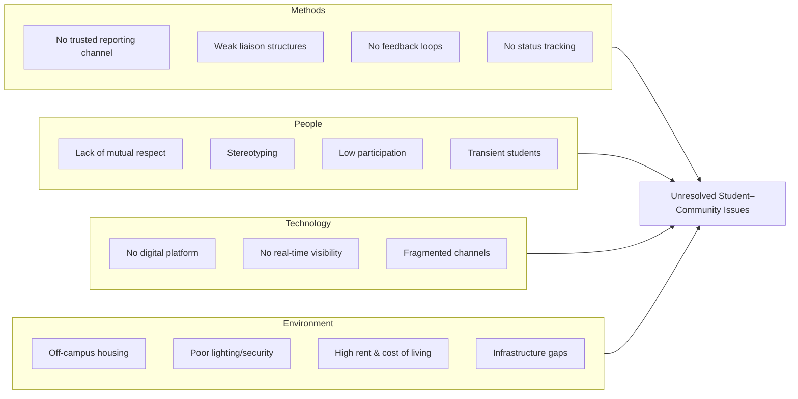

# Ishikawa (Fishbone) Problem Analysis  
## CommunityPulse – AAUA Students & Host Community

**Developer:** Ogunaja Samson Ayomide  
**Matric Number:** 220404117  
**Course:** CSC 426  

---

## Problem Statement (Effect)
**Unresolved community and student issues between AAUA students and host-community indigenes (Akungba, Iwaro, Etioro, Ayegunle and surrounding areas), leading to insecurity, exploitation, mistrust and reduced quality of life.**

---

## Root Cause Categories

### 1. Methods (Process & Reporting)
- Absence of a trusted, accessible formal reporting channel
- Weak or inactive student–community liaison structures
- Delayed or zero feedback after complaints are made
- Informal complaint paths that lack accountability
- No standardised way to track resolution status

### 2. People (Awareness & Participation)
- Lack of mutual respect and understanding
- Stereotyping (students seen as outsiders, indigenes seen as hostile)
- Low participation in joint problem-solving
- Transient nature of the student population
- Limited awareness of existing complaint mechanisms

### 3. Technology (Access & Digital Tools)
- No simple, mobile-friendly digital platform for reporting
- Lack of real-time visibility of reported issues
- No shared dashboard for students, indigenes and administrators
- Dependence on fragmented WhatsApp groups and verbal reports

### 4. Environment (Physical & Social Context)
- Majority of students live off-campus in the host community
- Inadequate street lighting and security infrastructure
- High rent and rising cost of living
- Poor roads, drainage, water and power in parts of the community
- Scattered housing that complicates monitoring and response

---

## How CommunityPulse Addresses the Causes

| Category     | How CommunityPulse Helps                                      |
|--------------|---------------------------------------------------------------|
| Methods      | Provides a single, always-available digital reporting channel with clear status tracking |
| People       | Gives both students and indigenes equal access and visibility |
| Technology   | Lightweight browser-based interface that works on phones      |
| Environment  | Captures location-related and infrastructure issues under the Environment category |

---

## Draw.io Instructions
1. Open https://app.diagrams.net
2. Create a new diagram (Ishikawa template or blank)
3. Draw a horizontal spine ending in a box containing the Problem Statement
4. Add four main diagonal bones labelled: **Methods**, **People**, **Technology**, **Environment**
5. Attach the secondary causes listed above to each bone
6. Export as PNG/PDF and keep the `.drawio` source file

---

## Mermaid Version (for quick viewing / GitHub)

