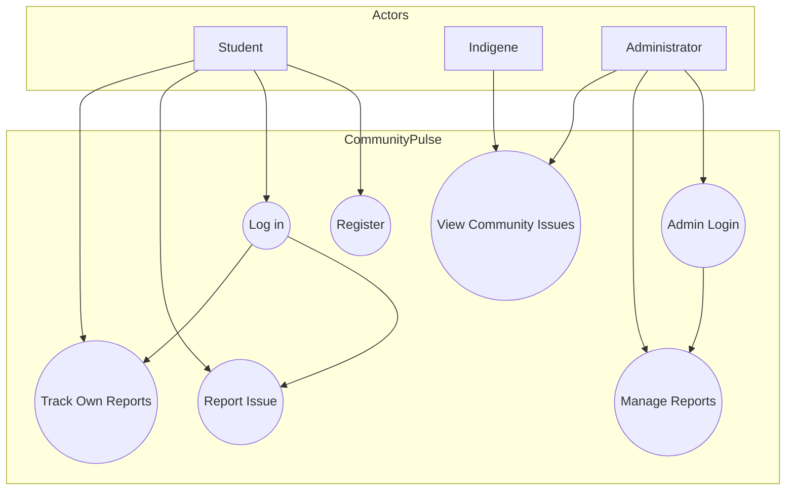

# Use-Case Diagrams & Descriptions  
## CommunityPulse

**Developer:** Ogunaja Samson Ayomide  
**Matric Number:** 220404117  
**Course:** CSC 426  

---

## 1. Actors

| Actor            | Description                                              |
|------------------|----------------------------------------------------------|
| Student          | AAUA student who registers, logs in, reports and tracks  |
| Indigene         | Host-community resident who views public reports         |
| Administrator    | System manager who reviews, updates status and deletes   |

---

## 2. Use Cases

### UC-1: Register as Student
**Actor:** Student  
**Description:** Create a new account with name, email and password.  
**Main Flow:**
1. Student selects “Student” role
2. Navigates to registration form
3. Enters full name, email and password
4. Submits form
5. System confirms registration and redirects to login

### UC-2: Log in as Student
**Actor:** Student  
**Preconditions:** Student has registered  
**Main Flow:**
1. Enters email and password
2. System validates credentials
3. Student is taken to personal dashboard

### UC-3: Report an Issue
**Actor:** Student  
**Preconditions:** Student is logged in  
**Main Flow:**
1. Fills title, category (Methods / People / Technology / Environment) and description
2. Submits report
3. Report appears immediately in “Your Reports” with status “Open”

### UC-4: Track Own Reports
**Actor:** Student  
**Description:** View list of reports previously submitted by the logged-in student, including current status.

### UC-5: View Community Issues
**Actor:** Indigene (also available to others)  
**Description:** Browse all reported issues with category, status, date and reporter name.

### UC-6: Log in as Administrator
**Actor:** Administrator  
**Main Flow:**
1. Enters username and password (demo: admin / admin)
2. System grants access to management dashboard

### UC-7: Manage Reports
**Actor:** Administrator  
**Description:**
- View summary statistics (Total, Open, In Progress, Resolved)
- Change status of any report (Open → In Progress → Resolved)
- Delete a report

---

## 3. Mermaid Use-Case Diagram



---

## 4. System Context (Simple)

```
     +------------------+
     |  AAUA Students   |
     +--------+---------+
              |
              v
+-------------+     +------------------+     +-------------------+
| Host        |---->|  CommunityPulse  |<----| Administrator     |
| Community   |     |  (Web Interface) |     | (University/SUG)  |
| Indigenes   |     +--------+---------+     +-------------------+
+-------------+              |
                             v
                    (Status updates & visibility)
```

These diagrams can be pasted into mermaid.live, GitHub Markdown, or imported into Draw.io.
